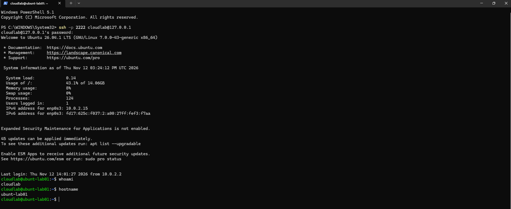
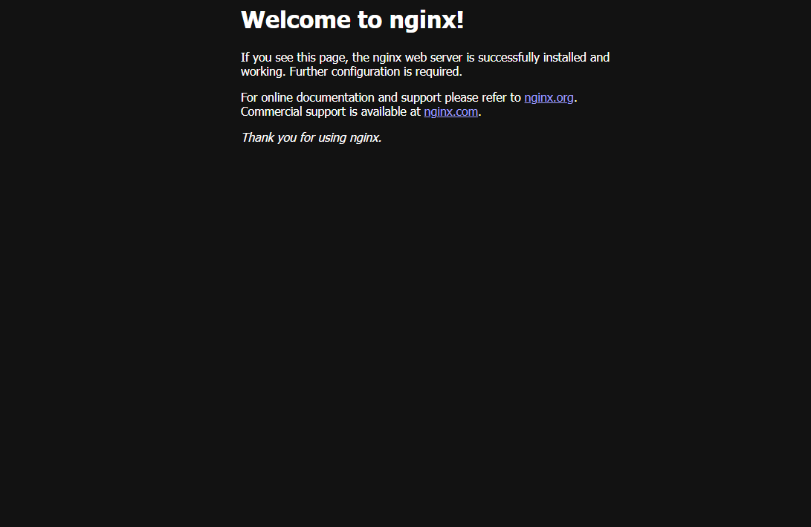

# Cloud Infrastructure Labs

## About Me

IT professional with over 10 years of experience in enterprise
IT operations, technical support and Major Incident Management.

Currently developing hands-on skills in Linux, Windows Server,
networking and Microsoft Azure, with the goal of transitioning
into Systems or Cloud Infrastructure Administration.

This repository showcases practical infrastructure projects,
technical configurations and troubleshooting experience.

## Completed Projects

### [Lab 01 — Ubuntu Server Administration](labs/01-ubuntu-server/README.md)

**Technologies:** Ubuntu Server, Oracle VirtualBox, SSH,
Windows PowerShell

**Objective:** Deploy an Ubuntu Server virtual machine and
establish remote administration from a Windows host.

**Implementation:**
- Installed and configured Ubuntu Server in VirtualBox.
- Configured NAT networking and TCP port forwarding.
- Enabled SSH remote administration.
- Verified connectivity from Windows PowerShell.

**Troubleshooting:**
Resolved an initial connectivity issue by identifying
that the virtual machine was powered off.

**Result:** Successfully established remote SSH access
from Windows to Ubuntu Server.

### [Lab 02 — Nginx Web Server Administration](labs/02-nginx-web-server/README.md)

**Technologies:** Ubuntu Server, Nginx, systemd, UFW,
VirtualBox, Windows PowerShell

**Objective:** Deploy and administer an Nginx web server
accessible from a Windows browser.

**Implementation:**
- Installed and configured Nginx.
- Managed Linux services using systemctl.
- Configured HTTP access and NAT port forwarding.
- Verified connectivity using curl and PowerShell.
- Inspected application logs.

**Troubleshooting:**
Resolved a command execution issue caused by running
a Windows PowerShell command inside a Linux SSH session.

**Result:** Successfully accessed the Nginx web server
from Windows through HTTP port forwarding.

## Technical Skills Practised

- Linux Server Installation and Administration
- Virtualisation with Oracle VirtualBox
- SSH Remote Administration
- Basic TCP/IP Networking
- NAT and Port Forwarding
- Linux Service Management
- Nginx Web Server Administration
- HTTP Connectivity Testing
- Basic Infrastructure Troubleshooting
- Technical Documentation

## Learning Roadmap

| Phase | Focus | Status |
|---|---|---|
| Month 1 | Linux Administration | In Progress |
| Month 2 | Windows Server & Active Directory | Planned |
| Month 3 | Networking & PowerShell | Planned |
| Month 4 | Azure & Microsoft Entra ID | Planned |
| Month 5 | Azure Infrastructure | Planned |
| Month 6 | Bicep, AZ-104 & Portfolio | Planned |

## Career Objective

Building on my enterprise IT operations background to
transition into a hands-on Systems Administrator,
Infrastructure Administrator or Azure Cloud Administrator role.

My focus is on practical system configuration, infrastructure
operations, troubleshooting and continuous technical development.

---

*Personal learning portfolio documenting practical laboratory
experience rather than professional production deployments.*
