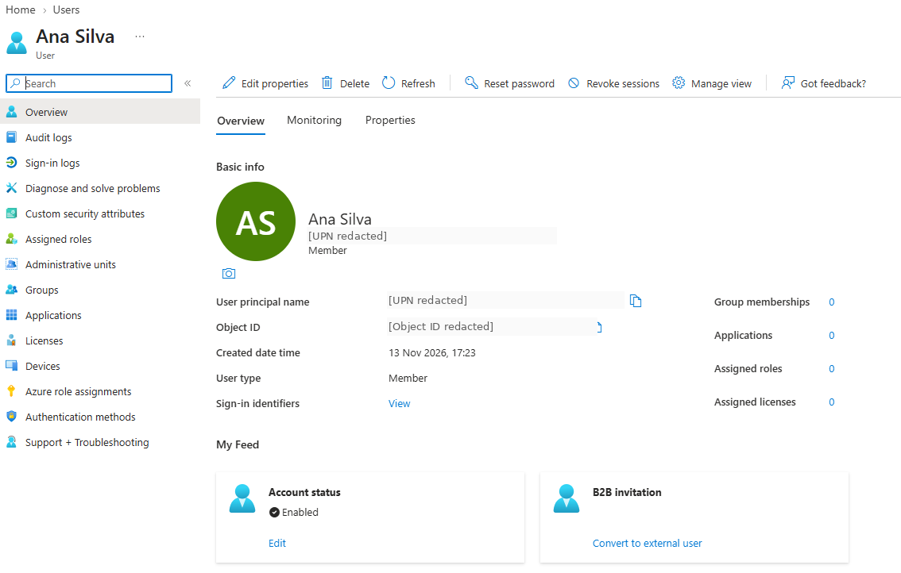

# Lab 01 — Microsoft Entra ID User Management

**Status:** Completed

## Objective

Provision and verify a standard internal user account in Microsoft Entra ID against a simulated, approved identity-management request.

## Ticket IAM-002 — New User Request

Create an internal Member account for fictional employee Ana Silva. No groups, licences or administrative roles requested.

## Tasks Completed

- Signed in to the Microsoft Entra admin center.
- Inspected the tenant's existing user directory.
- Created a standard user account for Ana Silva.
- Verified the account is enabled with Member user type.
- Verified group memberships, administrative roles and assigned licences all show zero.

## Evidence

*The user principal name (UPN) and Object ID have been redacted.*

## Outcome

Completed and verified the simulated user-provisioning ticket without assigning unnecessary privileges or licences.

*Personal training lab; no real employee account or production access request.*
