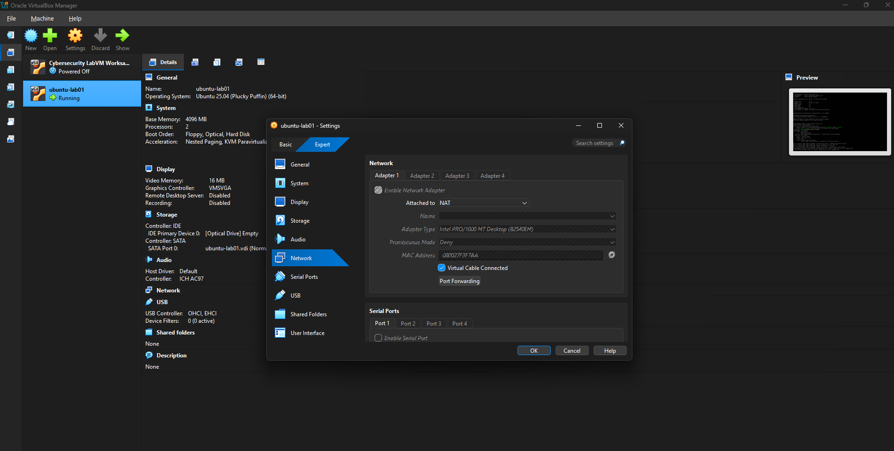
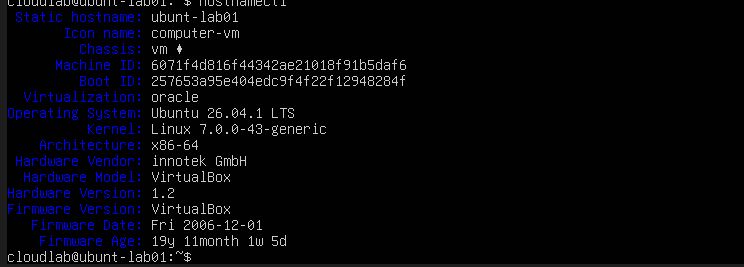
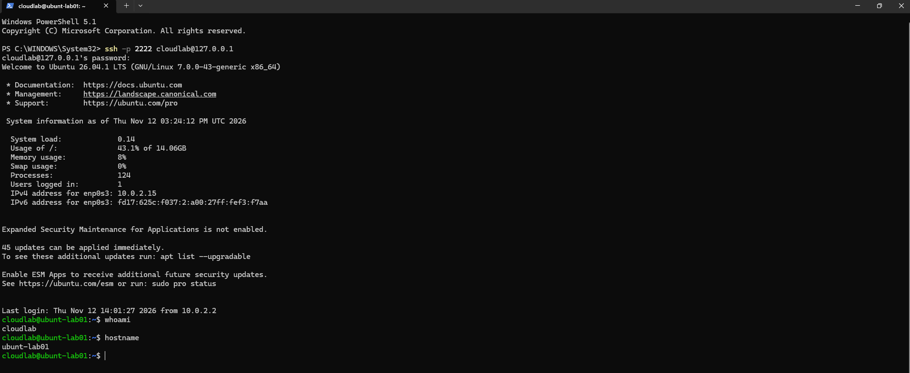
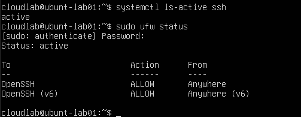

# Lab 01 — Ubuntu Server Administration

## Overview

This lab focuses on deploying and configuring an Ubuntu Server virtual machine using Oracle VirtualBox and establishing remote access from a Windows computer.

The objective is to gain practical experience with Linux server administration, virtualisation, networking, and remote connectivity.

## Lab Environment

| Component | Configuration |
|---|---|
| Host Operating System | Windows |
| Virtualisation Platform | Oracle VirtualBox |
| Guest Operating System | Ubuntu Server |
| Network Configuration | NAT |
| Remote Access Protocol | SSH |
| Host Port | 2222 |
| Guest Port | 22 |
| Client | Windows PowerShell |

## Tasks Completed

- Installed Ubuntu Server in Oracle VirtualBox.
- Created and configured a Linux virtual machine.
- Configured NAT networking.
- Configured TCP port forwarding for SSH connectivity.
- Set up SSH remote access.
- Successfully connected to Ubuntu Server from Windows PowerShell.

## Remote Access Configuration

To enable remote administration, I configured port forwarding in VirtualBox to allow SSH connections from the Windows host to the Ubuntu Server virtual machine.

The following command was used in Windows PowerShell:

`ssh -p 2222 cloudlab@127.0.0.1`

The connection was successfully established, allowing remote administration of the Linux server directly from Windows.

## Skills Practised

- Linux Server Installation
- Oracle VirtualBox
- Virtual Machine Configuration
- Basic TCP/IP Networking
- NAT and Port Forwarding
- SSH Remote Administration
- Windows PowerShell
- Basic Infrastructure Troubleshooting

## Challenges and Learning Outcomes

This lab provided practical experience in configuring remote connectivity between a Windows host and a Linux virtual machine.

During the configuration process, the initial connectivity test failed. The issue was identified as the virtual machine not being powered on.

After starting the virtual machine and confirming the configuration, the SSH connection was successfully established.

This exercise helped reinforce the importance of checking system availability and connectivity when troubleshooting infrastructure issues.

## Evidence

### VirtualBox Network Configuration

### Ubuntu Server Information

### SSH Connection

### SSH Service and Firewall

