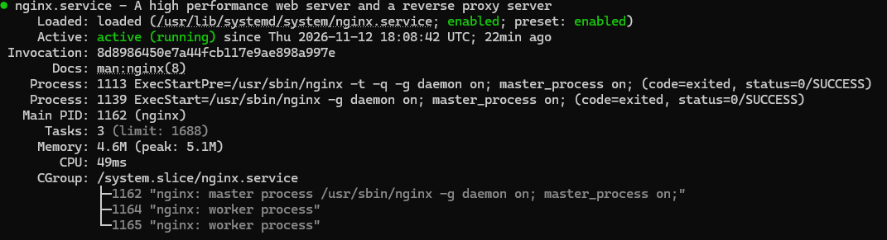
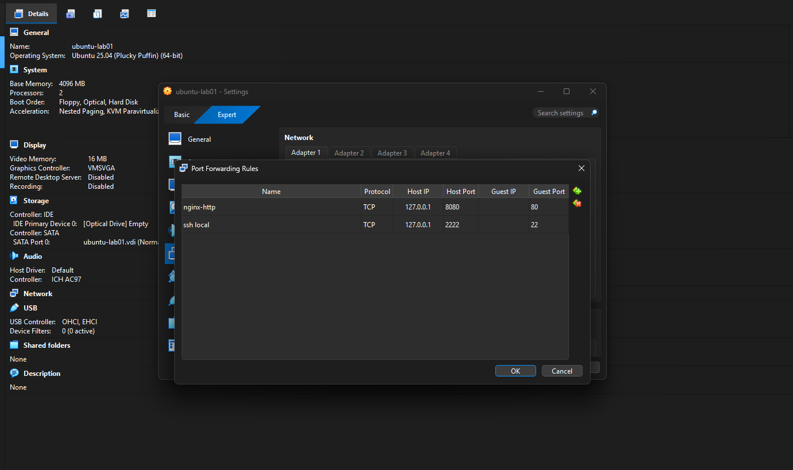
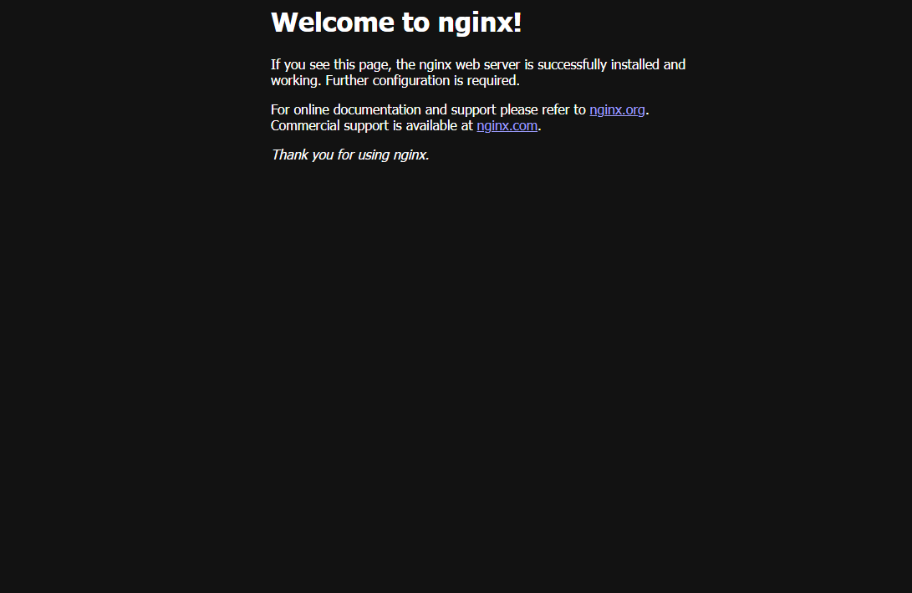

# Lab 02 — Nginx Web Server Administration

**Status: Completed**

## Overview

This lab focuses on installing, configuring, and administering an Nginx web server on Ubuntu Server.

The objective was to gain practical experience with Linux service management, HTTP connectivity, firewall configuration, network port forwarding, and service troubleshooting.

The web server was deployed inside an Ubuntu Server virtual machine running on Oracle VirtualBox and accessed from a Windows host.

## Lab Environment

| Component | Configuration |
|---|---|
| Host Operating System | Windows |
| Virtualisation Platform | Oracle VirtualBox |
| Guest Operating System | Ubuntu Server |
| Web Server | Nginx |
| Service Management | systemd / systemctl |
| Network Configuration | NAT |
| HTTP Guest Port | 80 |
| HTTP Host Port | 8080 |
| Remote Administration | SSH |
| Browser Access | http://127.0.0.1:8080 |

## Tasks Completed

- Installed Nginx using the APT package manager.
- Verified the installation and service status.
- Started, stopped, and restarted Nginx using systemctl.
- Configured automatic service startup.
- Tested HTTP connectivity using curl.
- Inspected Nginx access and error logs.
- Configured firewall access for HTTP traffic.
- Configured VirtualBox NAT port forwarding.
- Tested HTTP connectivity from Windows PowerShell.
- Successfully accessed the Nginx webpage from Windows.

## Nginx Installation

Updated the package list and installed Nginx:

```bash
sudo apt update
sudo apt install nginx -y
```

Verified the installation:

```bash
nginx -v
```

## Linux Service Management

Practised managing the Nginx service using systemctl:

```bash
sudo systemctl status nginx
sudo systemctl stop nginx
sudo systemctl start nginx
sudo systemctl restart nginx
sudo systemctl enable nginx
```

Verified service availability:

```bash
systemctl is-active nginx
```

Expected and confirmed result:

`active`

This exercise provided practical experience with Linux service administration and the systemd service manager.

## HTTP Connectivity Testing

Tested HTTP connectivity directly from Ubuntu Server:

```bash
curl -I http://127.0.0.1
```

Result:

`HTTP/1.1 200 OK`

This confirmed that the Nginx web server was responding to HTTP requests.

## Log Inspection

Inspected Nginx access and error logs using:

```bash
sudo tail -n 10 /var/log/nginx/access.log
sudo tail -n 10 /var/log/nginx/error.log
```

This exercise introduced basic application log inspection and troubleshooting.

## Firewall Configuration

Configured the Ubuntu firewall to allow HTTP traffic:

```bash
sudo ufw allow 80/tcp
sudo ufw status
```

## VirtualBox Network Configuration

Configured NAT port forwarding to allow the Windows host to access the Ubuntu web server.

| Rule | Host IP | Host Port | Guest Port |
|---|---|---|---|
| SSH | 127.0.0.1 | 2222 | 22 |
| HTTP | 127.0.0.1 | 8080 | 80 |

This allowed local communication between Windows and the Ubuntu virtual machine.

## Windows Connectivity Test

Executed the following command in Windows PowerShell:

```powershell
Test-NetConnection 127.0.0.1 -Port 8080
```

Result:

`TcpTestSucceeded : True`

The Nginx webpage was then successfully accessed using a Windows browser:

`http://127.0.0.1:8080`

## Challenges and Learning Outcomes

During connectivity testing, the PowerShell Test-NetConnection command initially failed because it was executed inside the Ubuntu SSH session.

The issue was resolved by exiting the SSH session and executing the command directly in Windows PowerShell.

This reinforced the importance of understanding the differences between Linux and Windows command environments.

The lab also provided practical experience in:

- Managing Linux services.
- Understanding HTTP connectivity.
- Configuring TCP port forwarding.
- Verifying service availability.
- Inspecting application logs.
- Testing communication between host and guest operating systems.
- Troubleshooting command execution and network connectivity.

## Skills Practised

- Ubuntu Server Administration
- Nginx Web Server
- Linux Service Management
- systemctl and systemd
- APT Package Management
- HTTP Fundamentals
- TCP/IP Networking
- NAT and Port Forwarding
- UFW Firewall Configuration
- Windows PowerShell
- Log Inspection
- Infrastructure Troubleshooting

## Evidence — Lab 02

### 5. Nginx Service Status



### 6. HTTP Port Forwarding



### 7. Nginx Website Access from Windows



## Lab Outcome

Successfully deployed and administered an Nginx web server on Ubuntu Server, configured HTTP connectivity through Oracle VirtualBox, and accessed the website from a Windows host.
